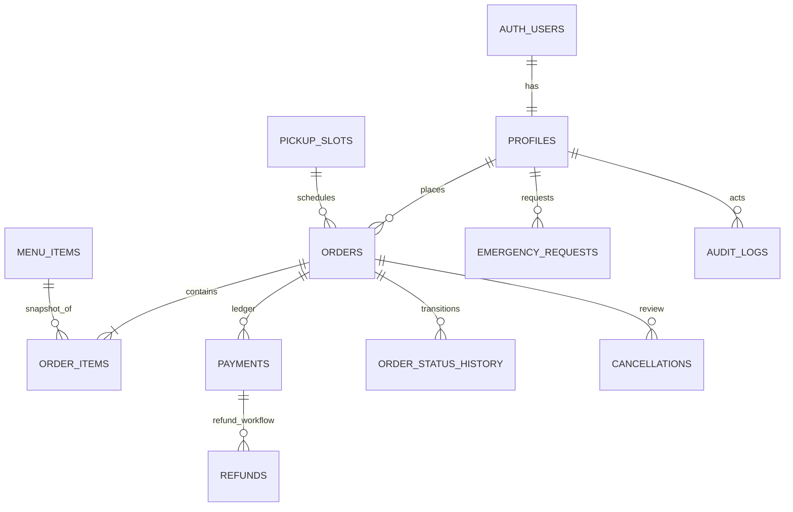

# Database design

Apply `database/migrations/001_initial_schema.sql` before `database/seed.sql`. All currency values are integer paise; `discount_paise` is constrained to zero. Order items preserve historical item name, price and quantity snapshots. Role, hostel verification and restriction changes are only available through owner-authorized server routes.

## ER diagram

RLS is enabled on all application tables. Client-side reads are scoped to own data or canteen staff; financial and order mutations are only performed by validated Express endpoints using the server-only service-role key. Checkout currently uses the `create_campusbite_order` PostgreSQL RPC, which locks the profile, pickup slot and menu rows with `FOR UPDATE`, calculates totals, writes snapshots, and reserves inventory/capacity in a single transaction. Emergency acceptance uses a separate transactional RPC. A production deployment should still add an unpaid-order expiry/release worker and compensation if creating an external Razorpay order fails after the database transaction commits.
