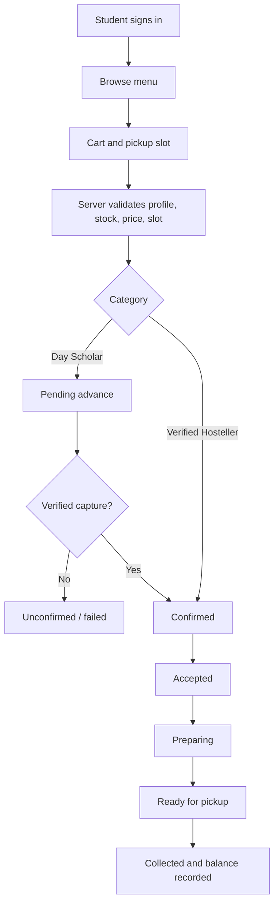

# CampusBite — Project Report

## Abstract
CampusBite is a responsive campus canteen pre-ordering and order-management system designed to reduce queues, improve pickup predictability and provide transparent payment handling. Students browse food, choose a pickup slot and track order status. Staff process orders, while owners manage menu availability, student privileges, restrictions and metrics.

## Problem statement
Short campus breaks are often consumed by canteen queues; staff have limited visibility into upcoming demand and informal payment rules can be inconsistent. CampusBite provides a central, auditable ordering workflow.

## Objectives
1. Responsive and accessible menu with search and categories.
2. Server-side price calculations and historical price snapshots.
3. Exact Day Scholar / verified Hosteller payment rules.
4. Server-side role enforcement.
5. Track status changes, cancellations, refund state and emergency requests.
6. Provide owner metrics and a configurable anti-prank review process.

## Technology
React, TypeScript, Vite, Tailwind CSS, Lucide, Express, Zod, Supabase Auth/PostgreSQL, Razorpay test mode, Vitest.

## Payment policy
All amounts are integer paise. Day Scholars pay 10% in advance and 90% after receiving food. Verified Hostellers pay no advance and 100% after receiving food. Discounts are always zero. Simulator mode is development-only and never represents real money movement.

## Workflow

## Design
Warm off-white backgrounds, deep green primary actions, orange accents, clear typography, responsive menu cards, loading/empty/error notices, cart drawer and transparent checkout summary.

## Limitations and future work
For high-concurrency deployment, move stock and pickup-slot reservation into a single transactional Postgres function; add unpaid reservation expiry, fully automated refund API calls, a dedicated slot/policy admin UI, real-time order updates and production monitoring. Supabase and Razorpay require external project credentials.
